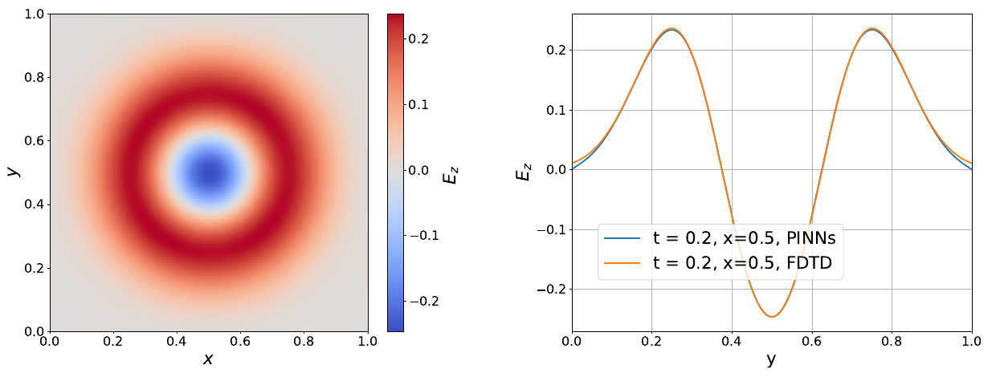
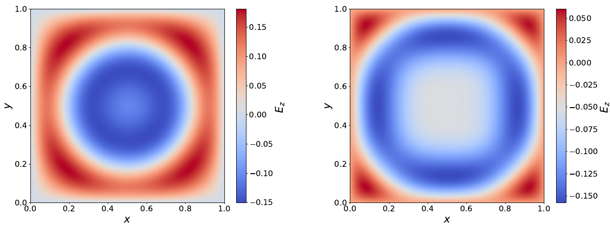

# 2D Maxwell's equations with a split-field PML, solved by a PINN

A physics-informed neural network (PINN) that solves the time-domain 2D Maxwell
equations (TMz polarization) in an open region. The region is truncated by a
Bérenger split-field perfectly matched layer (PML). It is built with
[DeepXDE](https://github.com/lululxvi/deepxde) on the PyTorch backend.

The network is not trained on simulation data. It learns the field only from the
PDE residual and the boundary and initial conditions.

This code reproduces the 2D example (Section 3.2) of the paper:

> X. Liu, L. Li, G. Moss, and S. Langdon, "Physics-Informed Neural Networks for
> the Time-Domain Maxwell Equations with Split-Field Perfectly Matched Layers,"
> [arXiv:2606.25323](https://arxiv.org/abs/2606.25323), 2026.

## Problem setup

- A Gaussian Ez pulse starts at the center of the unit square and radiates outward.
- The physical region is $[0.2, 0.8]^2$. It is surrounded by a PML that is 0.2 thick.
- The outer boundary is a perfect electric conductor (PEC), where $E_z = 0$.
- The simulation covers $t \in [0, 0.8]$.

Everything is normalized. Lengths are in units of $L_0 = 4\,\text{m}$ and times in
units of $T_0 = L_0 / c_0$, so the wave speed is 1.

## Formulation

The network maps $(x, y, t) \mapsto (E_{zx}, H_x, H_y, E_{zy})$. The physical
field is $E_z = E_{zx} + E_{zy}$. The split-field equations are:

$$
\begin{aligned}
\partial_t E_{zx} + \sigma_x E_{zx} &= \partial_x H_y \\
\partial_t E_{zy} + \sigma_y E_{zy} &= -\partial_y H_x \\
\partial_t H_x + \sigma_y H_x &= -\partial_y E_z \\
\partial_t H_y + \sigma_x H_y &= \partial_x E_z
\end{aligned}
$$

The conductivity is zero in the physical region. Inside the PML it follows a cubic
profile, $\sigma(d) = \sigma_{\max}\,(d/0.2)^3$ with $\sigma_{\max} = 10$, where
$d$ is the depth into the layer. The electric and magnetic conductivities are equal
(the matched condition), so in theory the interface between the region and the
PML does not reflect.

### Loss terms

| Term | Collocation points | Weight |
|---|---|---|
| 4 PDE residuals | 100,000 Sobol points in space-time | 1 |
| PEC: $E_{zx} = E_{zy} = 0$ on each of the 4 edges (8 terms) | boundary samples | 1 |
| $H_x = H_y = 0$ at $t = 0$ | 1,000 initial samples | 1 |
| $E_{zx} = e^{-40 r^2}$ at $t = 0$ | 141 × 141 grid | 10 |
| $E_{zy} = 0$ at $t = 0$ | 141 × 141 grid | 1 |

Here $r$ is the distance from the domain center. All of the initial field is placed
in $E_{zx}$. Any split works, because only the sum is physical and the
conductivity is zero where the pulse starts.

### Network and training

- Fully connected network, 3 → 4 × 80 → 4, with `sin` activation.
- 10,000 Adam iterations (lr 2e-3), then L-BFGS until convergence.

## Results

The figures are from the paper. At $t = 0.2$, the PINN solution agrees closely with
an FDTD reference solution computed with $\Delta x = \Delta y = 0.00125$. The small
difference near the edges is expected: the FDTD reference was run on a larger
domain without a PML.


*Left: $E_z$ at $t = 0.2$. Right: PINN vs. FDTD along $x = 0.5$ at $t = 0.2$.*

As the pulse reaches the PML, the layer absorbs it:


*$E_z$ at $t = 0.4$ (left) and $t = 0.56$ (right).*

## Running

```bash
pip install -r requirements.txt
python Maxwell2DSplitPML.py
```

The script writes $E_z$ snapshots at 21 times as `slice_XXXX.npz` (arrays `x`,
`y`, `E`, `t`) and `slice_XXXX.png`. All settings are constants at the top of the
script. Training uses 100k collocation points, so a GPU is recommended.

## Next steps

- **Temporally discretized PINNs**, to scale to higher-dimensional problems and
  longer simulation times.
- **Stronger PML absorption.** Absorption grows with $\sigma_{\max}$ and the layer
  thickness. Larger conductivities make the PDE stiffer, though, and harder for a
  PINN to train. Balancing the two matters for longer simulations.

## Citation

```bibtex
@misc{liu2026pinnpml,
  title         = {Physics-Informed Neural Networks for the Time-Domain Maxwell Equations with Split-Field Perfectly Matched Layers},
  author        = {Liu, Xiaodong and Li, Lingquan and Moss, Gregory and Langdon, Scott},
  year          = {2026},
  eprint        = {2606.25323},
  archivePrefix = {arXiv},
  primaryClass  = {math-ph}
}
```
